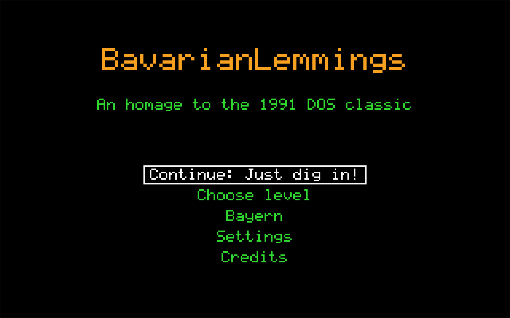
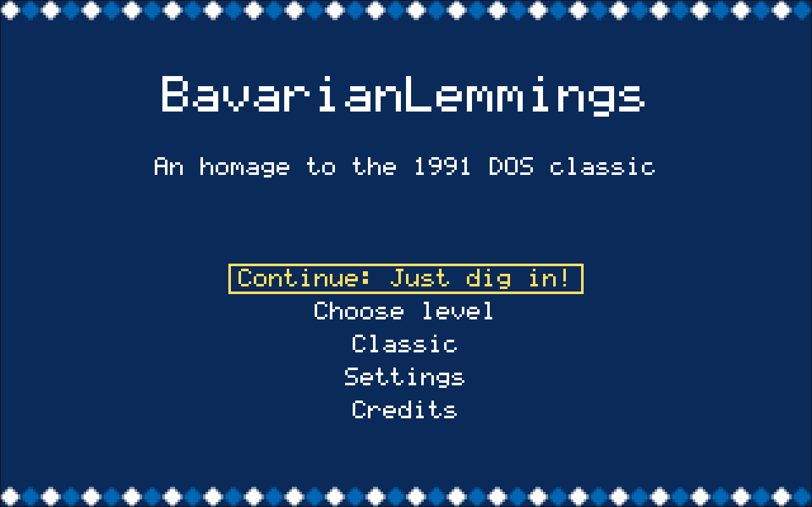
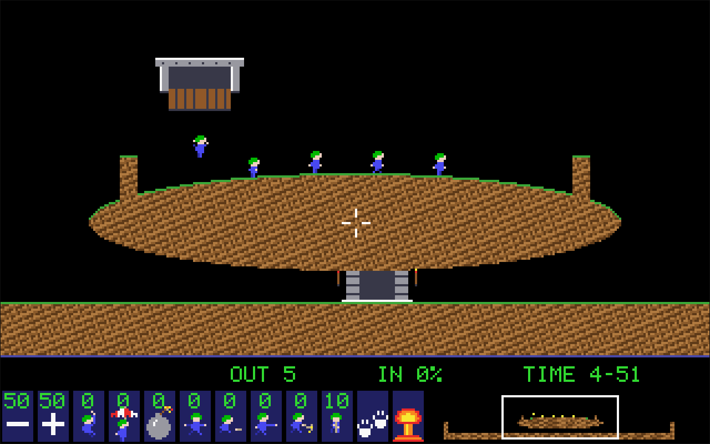
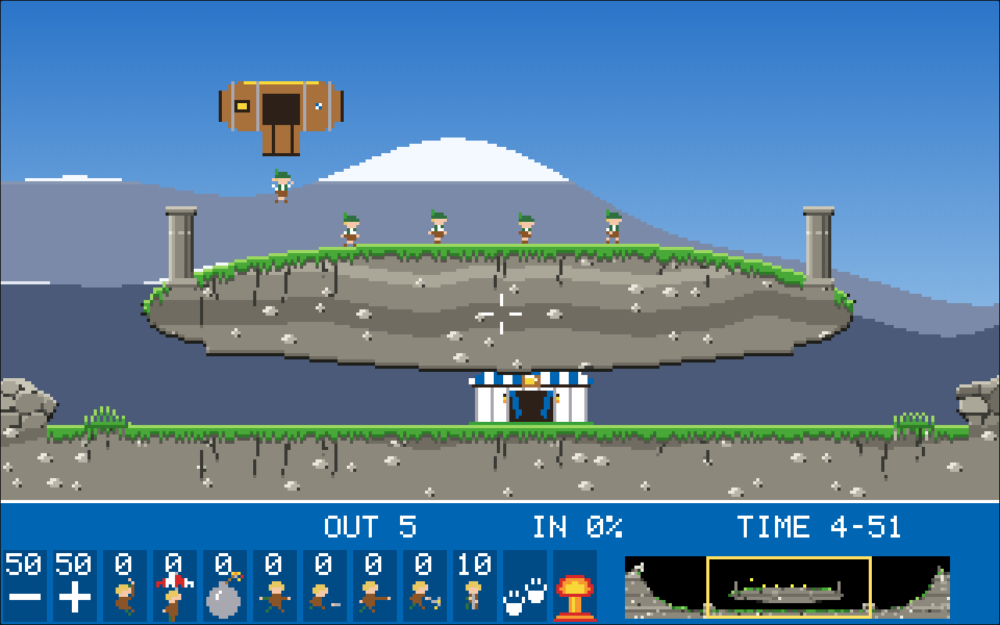
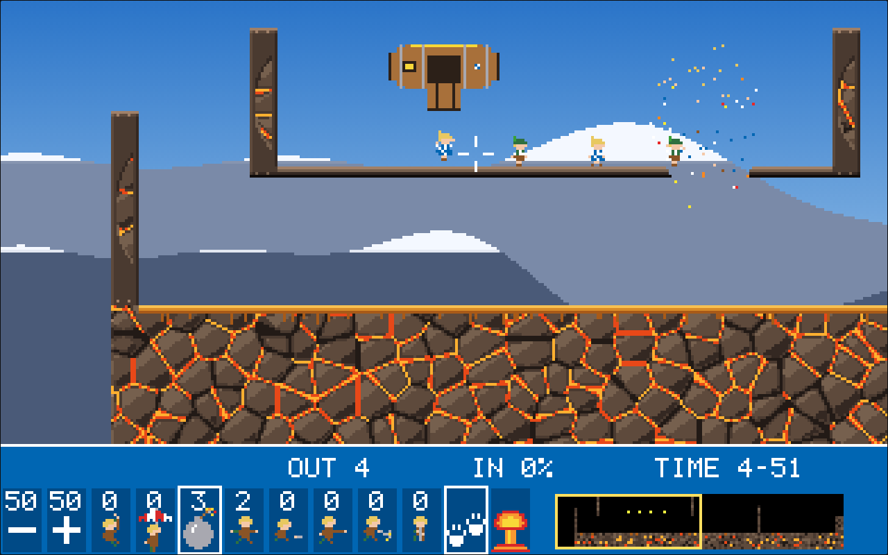
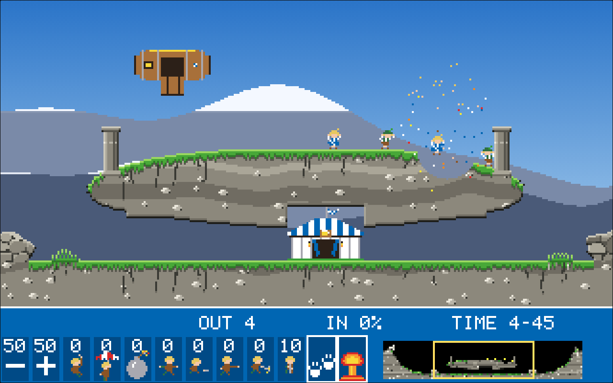

<!--
SPDX-FileCopyrightText: 2026 Marcel Petrick
SPDX-License-Identifier: GPL-3.0-or-later
-->

# BavarianLemmings

[](https://marcelpetrick.github.io/BavarianLemmings/)
[](https://github.com/marcelpetrick/BavarianLemmings/actions/workflows/ci.yml)
[](https://github.com/marcelpetrick/BavarianLemmings/actions/workflows/pages.yml)
[](https://github.com/marcelpetrick/BavarianLemmings/pkgs/container/bavarianlemmings)
[](https://github.com/marcelpetrick/BavarianLemmings/releases/latest)
[](LICENSE)
[](https://reuse.software/)
[](https://www.typescriptlang.org/)
[](https://vite.dev/)
[](https://vitest.dev/)
[](https://playwright.dev/)
[](vite.config.ts)
[](https://nodejs.org/)

An homage to **Lemmings**, the 1991 DOS game, running natively in the browser (Firefox and Chrome).
**Bavarian mode is the default**, with white and blue, mountains, Alpine folk music, Lederhosen,
Dirndl outfits and Weißwurst traps. Classic mode remains available in settings; saved choices persist.

## Play

Open **<https://marcelpetrick.github.io/BavarianLemmings/>** in a desktop browser. No install, no
account. Progress and settings stay in your browser.

> **Status:** playable prototype, v0.1.52. All 30 Fun levels have winning replays. Eight skills,
> desktop and tablet controls, three languages, both themes, audio and offline play work.
> Tricky, Taxing, Mayhem and original-layout reconstruction remain open in [plan.md](plan.md).
>
> | Document | Answers |
> | --- | --- |
> | [vision.md](vision.md) | What: specification list, decisions, status, resume point |
> | [architecture.md](architecture.md) | How: decision rule, candidates, chosen structure, formats |
> | [plan.md](plan.md) | What next: checkable tasks per milestone and the Gantt roadmap |
> | [AGENTS.md](AGENTS.md) | Rules for anyone (human or agent) working here |

## Screenshots

Captured from the production build by [`scripts/screenshot.mjs`](scripts/screenshot.mjs)
(`npm run screenshots`).

| Classic | Bavarian |
| --- | --- |
|  |  |
|  |  |

The enlarged bomber blast removes terrain within **16 logical pixels** (previously 8). Steel stays
intact. The screenshots below use actual game events, with no edited simulation state.

| Individual bomber blast | Confirmed nuke blast |
| --- | --- |
|  |  |

[Bomber aftermath](docs/screenshots/bavarian-bomber-aftermath.png),
[first nuke press](docs/screenshots/bavarian-nuke-armed.png), and
[Fun 6 before the blast](docs/screenshots/bavarian-fun06.png).

Whole-level inspection renders use a black background to expose overlaps outside the initial view:
[Classic catalogue](docs/screenshots/levels-classic.png),
[Bavarian catalogue](docs/screenshots/levels-bavarian.png).
Regenerate them with `npm run levels:preview` and `BL_THEME=bavarian npm run levels:preview`;
labelled contact sheets are written to `.tools/level-previews/`.

## Controls

The DOS function keys work as in the original. Browsers keep F11 (full screen) and F12 (developer
tools) for themselves, so every command also has a plain key.

| Input | Action |
| --- | --- |
| Mouse, left click on the panel | Select a skill, change the release rate, pause, nuke |
| Mouse, left click on a lemming | Give the selected skill to that lemming |
| `F1` / `F2`, or `-` / `+` | Release rate down / up |
| `F3` to `F10`, or `1` to `8` | Select a skill: Climber, Floater, Bomber, Blocker, Builder, Basher, Miner, Digger |
| `F11`, `P` or `Space` | Pause |
| `F12` or `N`, pressed twice | Nuke (the second press confirms) |
| `←` / `→` or `A` / `D` | Scroll the view |
| `F` | Fast-forward (4×) |
| `R` | Restart the level |
| `.` | Step one frame (while paused) |
| `Z` | Zoom (2× view) |
| `Esc` | Back to the menu |
| `↑` / `↓`, `Enter` | Move through and choose menu items |

An individual bomber arms with one lemming click after selecting the skill, then starts its
five-second countdown. A zero counter means none are available: Fun 1 supplies no bombers; Fun 6
does. The global nuke needs a second press within one second; the first press displays its
confirmation instruction. On touch, hold for one second or tap twice. Restart clears confirmation.

Fast-forward, restart, frame step and zoom did not exist in the DOS original. The **Purist**
setting switches them off.

## Run it yourself

1. Install Node.js 24 and the pinned tools: `npm ci`.
2. Start the development server: `npm run dev`, then open the address it prints.
3. Or build and serve the production build: `npm run build`, then `npm run preview`, then open
   <http://localhost:4173>.

With Docker, no Node.js is needed:

```sh
docker run --rm -p 8080:80 ghcr.io/marcelpetrick/bavarianlemmings   # then open http://localhost:8080
docker build -t bavarianlemmings . && docker run --rm -p 8080:80 bavarianlemmings   # from source
```

The image is a node build stage and an nginx serve stage ([Dockerfile](Dockerfile),
[docker/nginx.conf](docker/nginx.conf)).

## Disclaimer

BavarianLemmings is an unofficial, non-commercial fan homage. It is not affiliated with or
endorsed by the rights holders of *Lemmings*. It contains no original graphics, sounds, music,
fonts or data files. Everything is made by the project itself or used under a free licence.

## Quality pipeline

```sh
npm ci                                # install the pinned tools
./localPipeline.sh                    # the gate every commit must pass
./localPipeline.sh --noRun            # the same, without launching the game (used by CI)
BL_DOCKER=1 ./localPipeline.sh --noRun  # also build and smoke-test the Docker image
```

`localPipeline.sh` runs these steps in order and names the step that fails:

1. Dependencies (`npm ci`), semantic version, licence file.
2. REUSE compliance (SPDX headers), Markdown lint, shellcheck, actionlint.
3. Plan covers every vision ID, original-game constants have provenance, translations complete.
4. Type check (`tsc`), ESLint, Prettier, Stylelint.
5. Unit and integration tests (Vitest) with coverage of at least 95 %.
6. Production build (Vite).
7. End-to-end tests in Chromium, desktop and tablet emulation (Playwright), against the
   production build. Firefox is play-tested by hand (`BL_E2E_FIREFOX=1` adds it to the suite).
8. Docker image build and smoke test (only with `BL_DOCKER=1`).

GitHub workflows:

| Workflow | Trigger | Does |
| --- | --- | --- |
| [ci.yml](.github/workflows/ci.yml) | push and pull request to `main` | `BL_DOCKER=1 ./localPipeline.sh --noRun` |
| [pages.yml](.github/workflows/pages.yml) | push to `main`, tags `v*` | run the pipeline, then deploy `dist/` to GitHub Pages |
| [docker.yml](.github/workflows/docker.yml) | push to `main`, `v*` tags | build and push `ghcr.io/marcelpetrick/bavarianlemmings` (`latest`, `sha-…`, `X.Y.Z`) |
| [release.yml](.github/workflows/release.yml) | `v*` tags | tag equals `package.json` version, pipeline, GitHub release with the zipped `dist/` |

## Scripts

| Script | Purpose |
| --- | --- |
| [`localPipeline.sh`](localPipeline.sh) | The single quality gate (steps listed above) |
| [`scripts/bump-version.sh`](scripts/bump-version.sh) | Raise the semantic version (`patch` by default, every commit) |
| [`scripts/commit.sh`](scripts/commit.sh) | Bump the version, run the pipeline, commit with the version in the subject, push |
| [`scripts/generate-voices.sh`](scripts/generate-voices.sh) | Regenerate the English and Bavarian voice lines with espeak-ng |
| [`scripts/pitch-wav.mjs`](scripts/pitch-wav.mjs) | Speed up a WAV file for the squeaky lemming voice (used by generate-voices.sh) |
| [`scripts/install-actionlint.sh`](scripts/install-actionlint.sh) | Download the pinned actionlint into `.tools/` |
| [`scripts/check-constants.mjs`](scripts/check-constants.mjs) | List the unverified original-game constants; fail if one lacks a status or source |
| [`scripts/check-translations.mjs`](scripts/check-translations.mjs) | Fail if a translation key is missing in a language or used in code but undefined |
| [`scripts/screenshot.mjs`](scripts/screenshot.mjs) | Capture both themes and bomber/nuke states (`docs/screenshots/`) from the production build with Playwright; `npm run screenshots` |
| [`scripts/docker-smoke.sh`](scripts/docker-smoke.sh) | Build the Docker image, run it, check index, JS asset, WAV MIME type and the game start; pipeline step with `BL_DOCKER=1` |
| [`scripts/gantt.mjs`](scripts/gantt.mjs) | Generate the roadmap Gantt chart in plan.md from the task list (`--write`, `--check`) |
| [`scripts/check-plan.mjs`](scripts/check-plan.mjs) | Fail if a vision.md ID has no plan.md task; `--summary` prints done/open per milestone |
| [`tests/tools/render-levels.test.ts`](tests/tools/render-levels.test.ts) | Render levels to PNG in node (real colours and sprites) into `.tools/level-previews/`; `npm run levels:preview`, filter with `BL_LEVEL=fun-05`, options `BL_SCALE=3`, `BL_GRID=40`, `BL_THEME=bavarian` |
| same file, `npm run pieces:gallery` | Render every terrain shape and piece in every style to `docs/terrain-pieces.png` ([docs/terrain-pieces.md](docs/terrain-pieces.md)) |

## Development

```sh
git clone https://github.com/marcelpetrick/BavarianLemmings.git
cd BavarianLemmings
npm ci
./localPipeline.sh
```

Work follows [plan.md](plan.md): tick a task in the commit that finishes it, bump the version with
`scripts/bump-version.sh`, keep `./localPipeline.sh` green, push. See [AGENTS.md](AGENTS.md).

## Licence

[GPL-3.0-or-later](LICENSE) © 2026 Marcel Petrick

## Resume here

- State: v0.1.52; owner play-test fixes are implemented and covered by regression tests.
- Check: `./localPipeline.sh --noRun`; include Docker with `BL_DOCKER=1`.
- Run: `npm ci && npm run dev`. Regenerate browser captures with `npm run screenshots`.
- Next: remaining original-layout and rating content in [plan.md](plan.md); 1.0 needs the owner.
