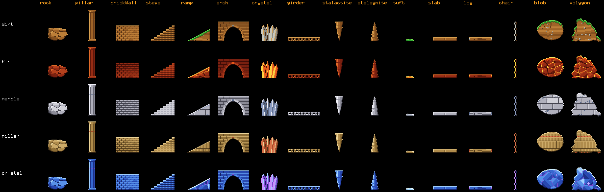

# Terrain shapes and pieces

This page lists every terrain shape of the level format and every piece of the piece library. Level
builders use it to dress a level. The code is in `src/sim/level.ts` (format and builder),
`src/sim/pieces.ts` (pieces) and `src/sim/texture.ts` (colours).

The picture shows each piece at its default size, one row per terrain style. Rebuild it with
`npm run pieces:gallery`.

## Terms

| Term | Meaning |
| --- | --- |
| *Shape* | One entry of the level's `terrain` list. Shapes are drawn in list order. A later shape paints over an earlier one. |
| *Mask* | Where terrain is solid. The simulation sees only the mask. |
| *Piece* | A shape of type `piece`: a drawing from the piece library, made by code, with its own shading. |
| *Style* | The level's `style`: `dirt`, `fire`, `marble`, `pillar` or `crystal`. It picks the texture and, with the theme, the colours. |
| *Seed* | A whole number that varies the irregular details of a shape. Same seed, same pixels. Without a seed, the shape's position is the seed. |
| *Erase* | `"erase": true` cuts the shape's pixels out of the terrain built so far. |

## Rules for builders

1. Coordinates are level pixels. `x` grows to the right, `y` grows downwards. The level is 160 px high.
2. `x`, `y`, `w` and `h` are whole numbers. `w` and `h` are at least 1.
3. A shape may stick out of the level. The part outside is cut off.
4. Lemmings walk on the mask. A step up of more than 6 px turns a walking lemming round. Keep
   decoration off walking paths, or make it part of the puzzle.
5. Steel areas (`steel` list) and one-way areas (`oneWay` list) are applied after all shapes. Steel
   shows as riveted plates; one-way areas show arrows.
6. Check the result with `BL_LEVEL=<id> npm run levels:preview` and open
   `.tools/level-previews/<id>.png`.
7. Check that the replay still wins with `npx vitest run tests/levels`.

## Shapes

| Shape | JSON | Parameters |
| --- | --- | --- |
| `rect` | `{ "shape": "rect", "x": 0, "y": 136, "w": 640, "h": 24 }` | Box from (`x`, `y`), `w` × `h` px. |
| `ellipse` | `{ "shape": "ellipse", "x": 200, "y": 78, "w": 240, "h": 44 }` | Ellipse filling the box. |
| `polygon` | `{ "shape": "polygon", "points": [[0, 160], [40, 60], [90, 160]], "rough": 0.8, "seed": 11 }` | At least three `[x, y]` corners. `rough` 0 to 1 (default 0): edges get crags up to 3 px deep; the corners stay put. |
| `blob` | `{ "shape": "blob", "x": 198, "y": 76, "w": 244, "h": 44, "rough": 0.25, "seed": 4 }` | Ellipse with a lumpy outline inside the box. `rough` 0 to 1 (default 0.5): lumps pull the edge in by up to 30 % of the radius, crags by up to 8 %. 0 gives a plain ellipse. |
| `piece` | `{ "shape": "piece", "piece": "pillar", "x": 213, "y": 66, "w": 10, "h": 26, "flip": false, "seed": 1 }` | `piece`: a name from the table below. `w`, `h`: size in px, the piece's default when left out. `flip`: mirror left to right (default false). |

Every shape also takes `"erase": true`. `rect`, `ellipse` and `polygon` without `rough` build exactly
the same mask as before the toolkit, so old levels keep their replays.

## Pieces

| Piece | Default w × h (px) | What it is | Parameters and behaviour |
| --- | --- | --- | --- |
| `rock` | 48 × 32 | Craggy boulder: angular, chipped outline, flat facets, a few cracks | `seed` changes the outline and the facets. The bottom half stays wide, so it sits on the ground. |
| `pillar` | 16 × 64 | Fluted column: slab and cushion capital, fluted shaft, stepped base, one carved ring | The shaft is `w` minus `w`/8 px on each side. The capital is the top 9 % of `h`, the base the bottom 7 %. |
| `brickWall` | 48 × 32 | Bricks of 8 × 4 px in running bond, dark mortar, some bricks darker | Fills the whole box. |
| `steps` | 48 × 32 | Staircase of stone blocks rising to the right | `flip: true` rises to the left. Number of steps: `h` / 4, at most `w` / 2. Each step rises `h` / steps px. |
| `ramp` | 48 × 24 | Solid wedge rising to the right | `flip: true` rises to the left. Takes the style's own texture. |
| `arch` | 64 × 40 | Masonry wall with a round opening at the bottom, voussoir stones and a keystone | Piers are 20 % of `w` (at least 4 px). The crown is 30 % of `h` (at least 6 px). The opening is empty (not solid). |
| `crystal` | 40 × 40 | Cluster of 3 to 5 pointed hexagonal shards, tallest in the middle | `seed` picks the shard count and sizes. Drawn in the accent colours, unlit. |
| `girder` | 64 × 8 | Riveted beam: top and bottom flanges, a web with round holes | Flanges are 2 px (1 px when `h` < 6). Holes appear when the web is at least 3 px high. The holes are empty. |
| `stalactite` | 16 × 40 | Cone hanging from its top edge, with growth rings | Place its top edge against a ceiling. `seed` bends and roughens it. |
| `stalagmite` | 16 × 40 | Cone standing on its bottom edge, with growth rings | Place its bottom edge on the ground. |
| `tuft` | 16 × 8 | Grass tuft on a small mound | Drawn in the style's surface colours (grass, glowing crust, frost), unlit. 8 px high: lemmings turn at it. |
| `slab` | 48 × 8 | Dressed stone slab, bevelled, joints every 24 px | A ledge or bridge. |
| `log` | 48 × 8 | Round wooden beam with grain, a knot and end rings | `seed` moves the knot. |
| `chain` | 6 × 40 | Hanging chain, links alternately face-on (with a hole) and edge-on | Solid like any terrain: lemmings can stand on it. Drawn in the accent colours, unlit. |

## Colours

The builder gives every solid pixel one of 16 colour slots. The theme maps slots to colours per
style (`src/render/palettes.ts`).

| Slots | Meaning |
| --- | --- |
| 1 to 7 | Brightness ramp: outline, deep shadow, shadow, body dark, body, body light, highlight |
| 8 to 10 | Surface layer: dark, middle, light (grass, crust, frost, snow) |
| 11 to 12 | Second material: middle, light (pebbles, embers, veins, carvings, crystals) |
| 13 to 15 | Steel: dark, middle, light (same in every style) |
| 16 | Builder brick |

Lighting comes from the top left:

- The top row of every shape is lit (style shapes get the style's surface layer).
- A pixel with air to its left is one step lighter; air to its right, one step darker.
- The underside row is the outline colour; the row above it is one step darker.

| Style | Classic texture | Bavarian look (V-09) |
| --- | --- | --- |
| `dirt` | Grass with hanging blades, earth strata, pebbles, roots | Alm: meadow on grey limestone |
| `fire` | Lava rock cells, glowing ember cracks, hot crust with drips | Hendl grill: charcoal, embers, golden crust |
| `marble` | Blocks of 24 × 12 px in running bond, mortar, veins | Wirtshaus: wooden planks with grain |
| `pillar` | Sandstone courses of 32 × 16 px, flutes, carved band in every second course | Maibaum: white and blue stripes, green and gold band |
| `crystal` | Large facets with their own tone, bright edges, sparkles, frost on top | Glacier: pale ice, snow, turquoise edges |

## Resume here

- State: the toolkit (M6.126) and the preview tool (M6.127) are done. Fun 1 is the showcase.
- Check: `npx vitest run tests/sim tests/levels` passes.
  `npm run pieces:gallery` rebuilds the picture above.
- Restart: to add a piece, add a function and an entry to `PIECES` in `src/sim/pieces.ts`, a row
  to the table above, and rerun `npm run pieces:gallery`. The piece tests in `tests/sim/pieces.test.ts`
  check every entry of the list automatically; add its name to the expected list there.
