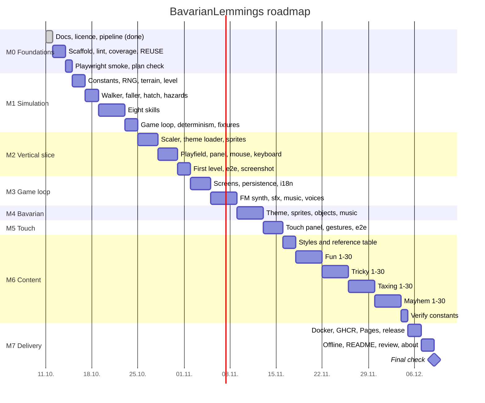

# BavarianLemmings: implementation plan

> Living checklist. [vision.md](vision.md) says what, [architecture.md](architecture.md) says how,
> this file says what to do next. Owner: Marcel Petrick. Last update: 2026-10-11.

## How to use this file

- Every task is one checkbox: `- [ ] M2.07 (G-02, R-03) text`. The ID is milestone-scoped and
  stable, the parentheses name the vision.md IDs the task satisfies. Tick it (`[x]`) in the same
  commit that finishes it.
- New work goes in here **first**, with the next free number at the end of its milestone. Never
  renumber. A dropped task is struck through (`~~M2.07~~`) with a reason, never deleted.
- A task is done when its code, its tests and its documentation are committed and the pipeline is
  green. Partial work stays unticked.
- Decisions taken while working go into the decision log of vision.md with the date.
- Every milestone ends with a version bump of the minor number (AGENTS.md), a pipeline run and an
  update of the "Resume here" section in vision.md.

## Assumptions taken on 2026-10-11 (owner delegated these)

| Topic | Decision | Reason |
| --- | --- | --- |
| Order of work (Q-D7) | Vertical slice first: one level playable end to end with mouse and keyboard, then the layers (audio, i18n, themes, touch), then the content. | Finds integration problems early; every milestone ships something playable. |
| Level recreation (Q-D8) | Levels are rebuilt by the agent from public level descriptions, walkthrough texts and memory. Geometry, pieces and names are ours. Each level JSON records `inspiredBy`. | Owner: "check what is available in the web"; X-02 forbids any original data. |
| Touch (Q-D1, Q-D3) | Mouse and keyboard are primary and are built first. Touch is a later layer (M5) with press-aim-release and side panels in landscape as proposed in vision 3.4.1; a plain-tap option is added if the e2e tests on tablet emulation show press-aim-release is awkward. | Owner: "primary input is mouse and keyboard, touch is something you have to work out". |
| Devices (Q-D2) | Desktop Firefox and Chrome are tested in CI. Tablets via Chrome on Android and Playwright tablet emulation. Safari on iPad and phones are best effort, not in CI. | Only Firefox and Chrome were ever required. |
| Fast-forward (Q-D4) | One speed, 4×, toggled by a button and by the `F` key; frame step with `.` while paused. | One speed keeps the panel simple; 4× matches the DOS tick rate times a comfortable factor. |
| Bavarian mode entry (Q-D5) | A theme toggle in settings **and** a "Bayern" button on the title screen. The theme does not change the language. | Discoverability without coupling two independent settings. |
| Level codes (Q-D6) | Deferred. Progress is saved in the browser; passwords can come later as a nostalgic extra. | Not needed for the goal; keeps M3 small. |
| Voices (Q-D9) | Voice lines follow the UI language. English and Bavarian sets exist. German UI uses the English set. | Owner: localized when switching to Bavarian; no German voice version. |
| Credits (Q-D10) | A credits screen with the owner's text: homage to the 1991 original, not affiliated, a browser recreation by Marcel Petrick, no original assets, no disassembled code, contact for any concern. | Owner. |

## Roadmap (Gantt)

Estimates for one agent working in sessions, starting 2026-10-12. Durations are calendar days and
are updated when a milestone closes. The chart is hand-maintained until `scripts/gantt.mjs`
(M0.18) generates it from the task list.

## M0: foundations (partly done)

- [x] M0.01 (Q) `vision.md` with the specification list, decision log and resume section.
- [x] M0.02 (Q) `AGENTS.md` with the working rules.
- [x] M0.03 (X-01) `LICENSE` with the GPL-3.0 text.
- [x] M0.04 (Q) `localPipeline.sh` with markdownlint, shellcheck, actionlint, semver and licence
      checks; `scripts/bump-version.sh`, `scripts/install-actionlint.sh`.
- [x] M0.05 (Q) `.github/workflows/ci.yml` running `./localPipeline.sh --noRun`.
- [x] M0.06 (Q) `README.md` with badges, status and the homage disclaimer.
- [x] M0.07 (R) `architecture.md`: decision rule, four candidates, choice, module map.
- [x] M0.08 (Q) `plan.md` (this file).
- [ ] M0.09 (Q) First push to `github.com/marcelpetrick/BavarianLemmings` and CI green there
      (owner pushes; the sandbox has no credentials).
- [ ] M0.10 (Q) Vite + TypeScript strict scaffold: `index.html`, `src/main.ts`, `vite.config.ts`,
      `tsconfig.json` with `noUncheckedIndexedAccess`, `exactOptionalPropertyTypes`.
- [ ] M0.11 (Q) Vitest with V8 coverage, threshold 95 % lines/branches/functions, in the pipeline.
- [ ] M0.12 (Q) ESLint (type-aware) with import-boundary rule for `src/sim`, Prettier, Stylelint;
      all in the pipeline.
- [ ] M0.13 (X-01) REUSE: `REUSE.toml`, SPDX headers on every source file, `reuse lint` in the
      pipeline; `THIRD_PARTY.md` created (empty table with licence columns).
- [ ] M0.14 (Q) `scripts/check-constants.mjs`: lists every `unverified` constant (architecture 6.2).
- [ ] M0.15 (Q) Playwright installed with Firefox and Chromium; one smoke test (page loads, canvas
      exists); in the pipeline and in CI with browser caching.
- [ ] M0.16 (Q) `scripts/check-plan.mjs`: every vision.md ID (G/L/V/C/A/P/R/I/X) is referenced by
      at least one plan task; fails the pipeline otherwise.
- [ ] M0.17 (Q) Pipeline step order documented in README; CI badge works after M0.09.
- [ ] M0.18 (Q) `scripts/gantt.mjs`: generates the Mermaid Gantt in this file from the milestone
      headings and tick state (dashboards follow the data); README refreshed from the same data.

## M1: headless simulation

- [ ] M1.01 (R-01, R-03) `src/sim/constants.ts` with every original-game number as a `constant()`
      with unit, status and source (tick rate, splat height, level size, lemming cap, release-rate
      bounds, builder bricks, bomber countdown, skill counts max 99).
- [ ] M1.02 (G-12) `src/sim/rng.ts` xorshift32 with tests for a known sequence.
- [ ] M1.03 (G-08) `src/sim/terrain.ts`: mask + palette image, `isSolid`, `clearMask`, `setBrick`,
      steel and one-way rules; unit tests with ASCII-art fixtures.
- [ ] M1.04 (L-03) `src/sim/level.ts`: Level type, JSON schema (`schemas/level.schema.json`),
      loader, validator; one hand-written test level `assets/levels/test/flat.json`.
- [ ] M1.05 (G-02) Walker and faller: walking, turning at walls, stepping up to N pixels, falling,
      fall distance counter, splat; fixtures for every edge (step up, step down, wall, cliff).
- [ ] M1.06 (G-01) Hatch and release rate: spawn timing from the release rate, bounds 1..99 and
      the level minimum, spawn order, initial direction from the RNG.
- [ ] M1.07 (G-09) Exit, drowning, out-of-bounds death, trap objects with trigger areas.
- [ ] M1.08 (G-03, G-04) Climber and floater: permanent flags, climbing geometry, falling back,
      floater opening delay, athlete combination.
- [ ] M1.09 (G-03, G-05) Bomber: countdown ticks, "oh no" state, crater mask, steel respected.
- [ ] M1.10 (G-03, G-06) Blocker: turn zone, freeing by crater or by removed ground.
- [ ] M1.11 (G-03, G-07) Builder: 12 bricks, brick geometry, head bump, shrug, turns at ceiling.
- [ ] M1.12 (G-03, G-07) Basher: tunnel mask per stroke, stops at steel and at empty space,
      one-way respected.
- [ ] M1.13 (G-03, G-07) Miner: diagonal stroke mask, stops at steel.
- [ ] M1.14 (G-03, G-07) Digger: vertical mask, stops at steel, falls when done.
- [ ] M1.15 (C-04) Skill assignment rules: which lemming under the cursor wins, which actions
      accept which skill, counters decrement.
- [ ] M1.16 (G-10, G-11) `game.ts`: `step(state, inputs)`, time limit, OUT/IN/saved counters,
      win/lose evaluation, pause, nuke with countdown wave.
- [ ] M1.17 (G-12) Determinism test: two runs with the same replay give identical state hashes;
      `replay.ts` with record and run.
- [ ] M1.18 (G-13) Edge-case fixtures as named tests: builder meets ceiling, basher meets steel,
      blocker on crumbling edge, digger into water, floater over trap, climber at overhang.
- [ ] M1.19 (G-14) Documented non-goal: no two-player code paths; a test asserts the public API
      has no second player.
- [ ] M1.20 (Q) Coverage of `src/sim` at 100 % lines; milestone bump to 0.1.0.

## M2: vertical slice (one level, mouse and keyboard)

- [ ] M2.01 (V-01) `render/scaler.ts`: integer scale factor from the viewport, letterbox, optional
      4:3 stretch, `image-rendering: pixelated`.
- [ ] M2.02 (V-07) Classic theme, first terrain style "dirt": hand-drawn pieces (ours), palette,
      a background; `theme.json` manifest and loader.
- [ ] M2.03 (V-05) Classic lemming sprite sheet (ours): walker, faller, climber, floater, bomber,
      blocker, builder, basher, miner, digger, splat, drown, exit, oh-no, shrug; frame counts
      documented per animation with their source.
- [ ] M2.04 (V-04) `render/playfield.ts`: terrain image with dirty-row redraw, objects, lemmings,
      horizontal scroll, selection box, bomber countdown digits.
- [ ] M2.05 (V-03) `render/panel/classic.ts`: 320×40 panel with release rate −/+, eight skill
      buttons with counts, pause, nuke, minimap with viewport; status line with lemming type under
      cursor, OUT, IN, TIME; bitmap font (ours).
- [ ] M2.06 (C-01) `input/pointer.ts`: mouse to intents, crosshair cursor, box cursor over a
      lemming, click to assign, panel clicks, minimap click, edge scrolling.
- [ ] M2.07 (C-02, C-03) `input/keyboard.ts`: F1/F2 release rate (direction per verified source),
      F3–F10 skills, F11 pause, F12 nuke, arrow keys scroll.
- [ ] M2.08 (R-03, P-04) `ui/app.ts`: rAF loop with tick accumulator, pause, visibility pause.
- [ ] M2.09 (R-04) `window.__bavarianLemmings` test hook in dev/test builds only.
- [ ] M2.10 (G-10) Result screen: saved vs. needed, retry or next.
- [ ] M2.11 (L-01a) First recreated level, Fun 1 equivalent ("Just dig!" idea): our geometry, our
      name, a recorded solution replay as its test.
- [ ] M2.12 (P-01) Playwright e2e in Firefox and Chrome: load the level, assign a digger by mouse,
      win; same by keyboard.
- [ ] M2.13 (C-05) Conveniences: fast-forward 4×, restart level, frame step, zoom (2× viewport);
      a Purist setting disables them.
- [ ] M2.14 (Q) README screenshot captured by Playwright (`scripts/screenshot.mjs`), committed;
      milestone bump to 0.2.0.

## M3: full game loop, audio, languages, persistence

- [ ] M3.01 (V-08) Title screen, level select by rating, level preview (L-04), settings screen,
      credits screen with the owner's text (see assumptions).
- [ ] M3.02 (L-02) `persist/storage.ts`: versioned keys, progress written on level completion,
      continue from the furthest level; in-memory implementation for tests; migration test.
- [ ] M3.03 (I-01, I-02) `i18n/`: EN, DE, BAR locale files, `t()`, fallback to EN, language in
      settings; `scripts/check-translations.mjs` in the pipeline.
- [ ] M3.04 (L-06) All level names and texts through i18n keys in all three languages.
- [ ] M3.05 (A-02) `audio/engine.ts`: unlock on first gesture, master/music/sfx volume, mute,
      settings persisted.
- [ ] M3.06 (A-03) `audio/fm.ts`: 2-operator FM voices with envelopes; a test renders a note to a
      buffer and checks the spectrum peak.
- [ ] M3.07 (A-01) Sound effects as synth recipes: hatch, let's go, oh no, explosion, splat,
      drown, exit, trap, builder brick, button click; mapped from sim events.
- [ ] M3.08 (A-05) Classic music: at least three of our own arrangements of public-domain melodies
      as note data, loop points, melody sources listed in `THIRD_PARTY.md` with public-domain
      evidence.
- [ ] M3.09 (A-01) Voice lines EN and BAR, generated by us offline (generator and licence noted
      in `THIRD_PARTY.md`), selected by UI language; DE falls back to EN.
- [ ] M3.10 (P-01) e2e: settings persist across reload, language switch changes the title text,
      audio unlock does not throw.
- [ ] M3.11 (Q) Milestone bump to 0.3.0.

## M4: Bavarian theme

- [ ] M4.01 (V-09) Bavarian `theme.json`: white-and-blue palette, mountain backgrounds, panel skin,
      Bavarian rating names; the sprite sheet geometry check in the pipeline.
- [ ] M4.02 (V-10) Bavarian lemming sprites in Lederhosen and Dirndl, same frames as classic.
- [ ] M4.03 (V-10) Bavarian objects: beer tent exit, maypole scenery, Weißwurst and Maßkrug traps,
      Bavarian hatch.
- [ ] M4.04 (V-07) Bavarian terrain styles mapped from the classic ones (dirt → Alm, marble →
      Wirtshaus wood, pillar → maypole, fire → Hendl grill, crystal → ice).
- [ ] M4.05 (A-04) Bavarian music: at least three of our own arrangements of traditional
      public-domain tunes (Ländler, Zwiefacher, march), sources in `THIRD_PARTY.md`.
- [ ] M4.06 (R-05) Theme switch in settings and a "Bayern" button on the title screen; theme
      persisted; switching reloads assets without reloading the page.
- [ ] M4.07 (P-01) e2e: switch to Bavarian, play the first level, screenshot for the README.
- [ ] M4.08 (Q) Milestone bump to 0.4.0.

## M5: touch

- [ ] M5.01 (C-06) `render/panel/touch.ts`: buttons at 48×48 CSS px minimum, landscape side
      columns, portrait bottom panel; `(pointer: coarse)` auto-selection with a settings override.
- [ ] M5.02 (C-06) `input/touchGestures.ts`: press-aim-release with magnifier, two-finger scroll,
      minimap drag, pinch zoom, one-second nuke hold with progress ring, release-rate repeat.
- [ ] M5.03 (C-06) `touch-action: none`, no context menu, fullscreen button, pause on hidden page.
- [ ] M5.04 (P-06) e2e with Playwright tablet emulation (`hasTouch`, landscape and portrait) in
      Chromium: play the first level by touch only.
- [ ] M5.05 (C-06) Decide plain-tap option from the e2e experience; document in vision decision log.
- [ ] M5.06 (Q) Milestone bump to 0.5.0.

## M6: content, all four ratings

Each level task means: our geometry and name, JSON passes the schema, a recorded solution replay
passes as a test, texts in three languages, `inspiredBy` filled in. Levels are grouped in batches so
progress is visible.

- [ ] M6.01 (L-01a) Collect public level descriptions (names, skill sets, lemming counts, rescue
      targets, time limits) as a reference table `docs/levels-reference.md` with sources; no
      original data files are downloaded.
- [ ] M6.02 (V-07) Remaining classic terrain styles: fire, marble, pillar, crystal, with pieces.
- [ ] M6.03 (L-01) Fun 1–10.
- [ ] M6.04 (L-01) Fun 11–20.
- [ ] M6.05 (L-01) Fun 21–30.
- [ ] M6.06 (L-01) Tricky 1–10.
- [ ] M6.07 (L-01) Tricky 11–20.
- [ ] M6.08 (L-01) Tricky 21–30.
- [ ] M6.09 (L-01) Taxing 1–10.
- [ ] M6.10 (L-01) Taxing 11–20.
- [ ] M6.11 (L-01) Taxing 21–30.
- [ ] M6.12 (L-01) Mayhem 1–10.
- [ ] M6.13 (L-01) Mayhem 11–20.
- [ ] M6.14 (L-01) Mayhem 21–30.
- [ ] M6.15 (V-06) Verify the tick rate, splat height, level size and lemming cap against
      behaviour documentation; flip the constants to `verified`; note the DOS 80-lemming cap.
- [ ] M6.16 (C-02) Verify the F1/F2 direction and the scroll keys against a documented DOS source.
- [ ] M6.17 (Q) Milestone bump to 0.6.0.

## M7: delivery

- [ ] M7.01 (P-03) `Dockerfile` (node:24 build, nginx:alpine serve), `.dockerignore`,
      `scripts/docker-smoke.sh` (build, run, curl index, one Playwright check); in the pipeline.
- [ ] M7.02 (P-03) `.github/workflows/docker.yml`: build and publish to GHCR on `v*` tags and on
      `main`.
- [ ] M7.03 (P-03) `.github/workflows/pages.yml`: deploy `dist/` to GitHub Pages; "Play in
      browser" badge.
- [ ] M7.04 (Q) `.github/workflows/release.yml`: on `v*` tags, check that the tag matches
      `package.json`, run the pipeline, attach the zipped `dist/`.
- [ ] M7.05 (P-05) Service worker for offline play after the first load; e2e: reload offline.
- [ ] M7.06 (Q) README complete: badges (Play, CI, Pages, Docker, Release, Licence, REUSE,
      Coverage, stack), setup, testing, pipeline, Docker, usage, screenshots of both modes.
- [ ] M7.07 (Q) `/reviewBranch`, fix every finding; `review_YYYYMMDD.md` with status per finding.
- [ ] M7.08 (Q) `/githubAbout`: description and topics applied.
- [ ] M7.09 (Q) Final check against every vision.md item (`scripts/check-plan.mjs` plus a manual
      pass); pipeline green locally and in CI; Docker image runs; tree clean; everything pushed.
- [ ] M7.10 (Q) Bump to 1.0.0 when the owner says so.

## Cross-cutting rules (apply in every milestone)

- Every commit: `scripts/bump-version.sh`, `./localPipeline.sh` green, conventional message.
- Every new script: header comment with purpose, usage and exit codes; README table entry.
- Every asset: ours (noted in the commit) or a `THIRD_PARTY.md` row with licence and URL.
- Every original-game number: a `constant()` with a source, never a literal.
- Every new vision.md ID: at least one plan task that references it.
